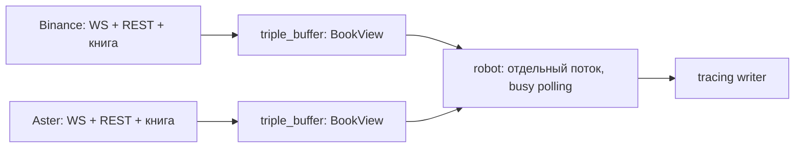

# Архитектура

Один процесс и Cargo package: два публичных гейта ETHUSDT и `robot` без исполнения ордеров. [Стек и параметры](../README.md) · [План](IMPLEMENTATION_PLAN.md).

Реализованы этапы 1–8, включая сетевые Binance/Aster. Supervision — этап 9; схема ниже описывает полный сервис.

## Потоки и данные

Четыре основных OS-потока: по Tokio current-thread на гейт, синхронный `robot` через `std::thread::spawn` и main/supervision. Логи пишет отдельный writer, REST snapshot разбирает ограниченный blocking pool.

`md::spawn_adapter` запускает корневую future в своём runtime. Один `select!` обслуживает WS, сохранённую HTTP future, разбор snapshot, таймеры и shutdown. Очередь ограничена по количеству и байтам; replay — по 32 сообщения. Единственный parse worker дожидаются даже после отмены синхронизации; результат старого `sync_epoch` отбрасывают.

Гейт владеет книгой: отсортированные предвыделенные `Vec`, merge через scratch, commit обеих сторон после проверок. Затем копирует все уровни в слот `BookView`: книга, покрытие, sequence, временные метки и статус. Читатель получает целостную версию; пара бирж не образует атомарный снимок. Пропуск публикаций допустим, входных diff — нет.

Робот непрерывно вызывает `update()` обоих буферов и считает при изменении любого. Пустая итерация использует `spin_loop()`. Дополнительных уведомлений и Tokio runtime в роботе нет; цикл проверяет также свежесть и stop-флаг. Цена — постоянная загрузка логического CPU.

`exchange_time` — время события биржи, `platform_time` — наше время получения сообщения до парсинга; оба в Unix ms. Возраст/skew считаются по сопутствующему монотонному `received_at: Instant`. Метки последнего применённого diff сохраняются при replay и публикации.

## Синхронизация и ошибки

WS-буферизация → snapshot `L` → отбросить `u < L` → первое `U <= L <= u` → далее `pu == previous_u`. Количество абсолютное, ноль удаляет уровень.

После синхронизации — `Online`. Старт, gap, разрыв, плохие данные, overflow, потеря покрытия или shutdown — `Offline`. Восстановление: snapshot/replay, при разрыве также reconnect/backoff. У каждого гейта свои книга, очередь, HTTP/WS, worker, backoff, watchdog, epoch и shutdown; общей изменяемой памяти между гейтами нет.

Смена статуса не освежает данные. Короткий `Offline` может быть пропущен читателем; причины и счётчики сохраняются в `metrics`.

## Числа и сигнал

`Fp = fixnum::FixedPoint<i64, U9>`; `Price`, `Qty`, `Amount` — newtype. Парсинг точный, арифметика checked; при потере точности — ошибка в лог вместо округления.

`robot` читает только опубликованные `book::BookView`: проверяет `Online`, возраст/skew и объём top-5. Считает при запуске, обновлении буфера, истечении свежести и для секундного вывода. Deadline проверяется в polling-цикле даже без сообщений. Отклонение mid Aster от Binance ниже −5 bps даёт `LongBias`, выше +5 — `ShortBias`, иначе `Hold`. Вывод — направление, статусы и числа обеих книг, при изменении направления/статусов и раз в секунду.

## Модули и эксплуатация

- `main`, `config` — запуск, параметры, supervision/shutdown.
- `md` — `MDAdapter`, общий сетевой цикл и синхронизация; `binance`, `aster` — endpoints, парсеры и реализации адаптеров со статической диспетчеризацией.
- `numeric`, `book` — числа, книга и публикация.
- `robot` — решение; `metrics` — диагностика.

`MDAdapter` получает данные, публикует книгу, восстанавливается и останавливается. Проверяем инварианты, отказы и независимость фидов; задержки измеряем release replay.
