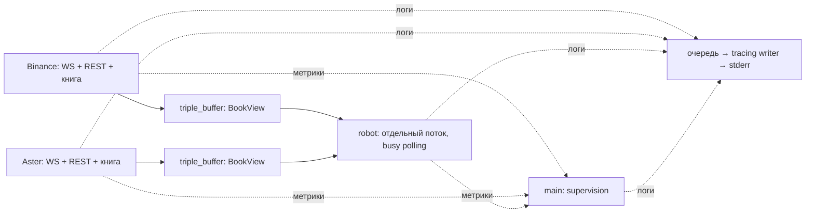

# Архитектура

Один процесс и Cargo package: два публичных гейта ETHUSDT и `robot` без исполнения ордеров. [Стек и параметры](../README.md) · [План](IMPLEMENTATION_PLAN.md).

Реализованы этапы 1–10: сервис проверен на локальных mocks и публичных фидах. [Результаты](VALIDATION.md); измерения — этап 11.

## Потоки и данные

Четыре основных OS-потока: по Tokio current-thread на гейт, синхронный `robot` в именованном OS-потоке и main/supervision. Логи пишет отдельный writer, REST snapshot разбирается через `spawn_blocking`: не более одного worker на гейт.

`md::spawn_adapter` запускает корневую future в своём runtime. Один `select!` обслуживает WS, сохранённую HTTP future, разбор snapshot, таймеры и shutdown. Очередь ограничена по количеству и байтам; replay — по 32 сообщения. Единственный parse worker дожидаются даже после отмены синхронизации; результат старого `sync_epoch` отбрасывают.

Гейт владеет книгой: отсортированные предвыделенные `Vec`, merge через scratch, commit обеих сторон после проверок. Затем копирует все уровни в слот `BookView`: книга, покрытие, sequence, временные метки и статус. Bids идут по убыванию, asks по возрастанию; вместимость — 8192 уровня на сторону. Читатель получает целостную версию; пара бирж не образует атомарный снимок. Пропуск публикаций допустим, входных diff — нет.

Робот непрерывно вызывает `update()` обоих буферов и считает при изменении любого. Пустая итерация использует `spin_loop()`. Дополнительных уведомлений и Tokio runtime в роботе нет; цикл проверяет также свежесть и stop-флаг. Цена — постоянная загрузка логического CPU.

`exchange_time` — время события биржи, `platform_time` — наше время получения сообщения до парсинга; оба в Unix ms. Возраст/skew считаются по сопутствующему монотонному `received_at: Instant`. Replay сохраняет исходное время получения; публикация статуса не меняет метки последнего применённого diff. Snapshot не задаёт время diff: оно появляется после первого принятого обновления.

## Синхронизация и ошибки

WS-буферизация → snapshot `L` → отбросить `u < L` → первое `U <= L <= u` → далее `pu == previous_u`. Количество абсолютное, ноль удаляет уровень. Точный дубль игнорируется; конфликтующий дубль, регрессия ID и разрыв цепочки запускают восстановление.

После bridge и опустошения очереди replay — `Online`. Книга хранит известные уровни snapshot + diff; для работы нужны минимум пять достоверных уровней с каждой стороны внутри покрытия snapshot. Старт, gap, разрыв, плохие данные, overflow, потеря покрытия или shutdown — `Offline`. Восстановление: snapshot/replay, при разрыве также reconnect/backoff. У каждого гейта свои книга, очередь, HTTP/WS, worker, backoff, watchdog, epoch и shutdown; общей изменяемой памяти между гейтами нет.

Один `Offline` делает инструмент недоступным для bias: робот выдаёт `Hold` до готовности обеих книг. `Offline` публикуется при обнаружении сбоя до любого ожидания восстановления; робот видит его при следующем чтении. Смена статуса не освежает данные. Короткий `Offline` между двумя чтениями может быть пропущен: triple buffer передаёт последнее состояние, а не очередь переходов. Причины и счётчики сохраняются в `metrics`, переход логируется самим адаптером.

Молчание фида обнаруживается watchdog через 3 с без применённого diff; Ping и дубли таймер не освежают. Робот раньше выдаёт `Hold` по max-age (по умолчанию 500 мс). База backoff растёт экспоненциально от 250 мс до 30 с, задержка выбирается между половиной базы и базой; учитывается `Retry-After`.

## Числа и сигнал

`Fp = fixnum::FixedPoint<i64, U9>`; `Price`, `Qty`, `Amount` — newtype. Парсинг точный, арифметика checked; при потере точности — ошибка в лог вместо округления.

`robot` читает только опубликованные `book::BookView`: проверяет `Online`, возраст ≤ 500 мс, skew ≤ 250 мс и объём top-5 ≥ 1 ETH на каждой стороне обеих книг. Это значения по умолчанию в `RobotConfig`, изменяемые через CLI; невыполнение любого условия даёт `Hold`. Считает при запуске, обновлении буфера, истечении свежести и для секундного вывода. Deadline проверяется в polling-цикле даже без сообщений. Отклонение mid Aster от Binance ниже −5 bps (порог по умолчанию) даёт `LongBias`, выше +5 — `ShortBias`, иначе `Hold`. Callback выдаёт решение при изменении направления/статусов и раз в секунду.

## Модули и эксплуатация

- `main`, `config` — CLI, параметры и SIGINT/SIGTERM; `service` — supervision/shutdown.
- `md` — `MDAdapter`, общий сетевой цикл и синхронизация; `binance`, `aster` — endpoints, парсеры и реализации адаптеров со статической диспетчеризацией.
- `numeric`, `book` — числа, книга и публикация.
- `robot` — решение; `metrics` — диагностика.

`MDAdapter` получает данные, публикует книгу, восстанавливается и останавливается. Проверяем инварианты, отказы и независимость фидов; измерения задержек на release replay запланированы в этапе 11.

`service` предвыделяет каналы и запускает workers. Каждые 10 мс проверяет их завершение, раз в секунду читает отдельные triple buffer с метриками. Эти 10 мс не задают период реакции робота. Ошибка/panic/неожиданный выход worker останавливает всех и возвращает ошибку. SIGINT/SIGTERM запускают тот же cleanup: stop робота, `watch` гейтам, `Offline`, ожидание parse worker и join только завершившихся потоков. Logging guard живёт до конца main.

## Логи

Формат: `LEVEL:timestamp: событие параметры`, время UTC, без имени модуля и span. В терминале смена bias выделяется зелёным фоном, Online — синим, Offline и WARN/ERROR — красным; при перенаправлении stderr цвета отключены. `RUST_LOG=info` по умолчанию включает также WARN/ERROR.

| Уровень | События |
| --- | --- |
| INFO | Только переходы инструмента Online/Offline (`venue`, `symbol`) и смена bias (`Aster bias changed`, поля `bias`, `symbol`) |
| WARN | Сбои фида и восстановление: gap, disconnect, timeout, некорректные данные, overflow |
| ERROR | Ошибки запуска/worker/сервиса и потеря числовой точности |
| DEBUG | Подключения, shutdown, краткие решения и периодические `feed state`/метрики сервиса |
| TRACE | Числа обеих книг для решения и подробные счётчики фидов |

Начальные Offline/Hold не считаются переходами; секундные отчёты не дублируют INFO. `feed state` содержит `venue`, `state`, `last_diff_id` — последний успешно применённый `u`. До первого diff ID отсутствует; дубли/ошибки его не меняют, восстановление не обнуляет.

Форматирование выполняется вызывающим потоком, вывод — отдельным writer через lossy-очередь на 4096 записей. Переполнение отбрасывает логи; `dropped_logs` учитывается отдельно от пропусков публикаций книг и gaps входного фида. `WorkerGuard` сбрасывает очередь при штатном выходе.
