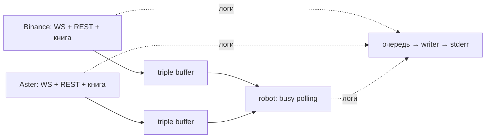

# Архитектура

Один процесс, два публичных фида ETHUSDT perpetual и сигнал без исполнения. [Параметры и URL](../README.md).

## Потоки и владение

По OS-потоку с Tokio current-thread runtime на адаптер, отдельный синхронный поток робота и main с supervision. Дополнительно — writer логов и не более одного blocking worker разбора snapshot на адаптер.

`MDAdapter` задаёт endpoints, декодирование и запуск. `binance`/`aster` содержат схемы своих площадок; `md::feed` — общий сетевой цикл. Один `select!` обслуживает WS, HTTP, результат разбора snapshot, таймеры и shutdown. Replay ограничен 32 сообщениями за итерацию. Старый parse worker дожидаются, результат другой `sync_epoch` отбрасывают.

Адаптер единолично владеет книгой. Декодер проверяет/сортирует уровни один раз; книга принимает нормализованные данные. Merge в предвыделенных `Vec` и scratch, commit обеих сторон после проверки. Публикация копирует все известные уровни в слот triple buffer. Читатель удерживает целостную версию до `update()`; снимки двух бирж независимы.

Робот непрерывно проверяет оба буфера. Считает при обновлении, истечении свежести или секундном deadline; пустой проход использует `spin_loop()`. Сеть не парсит. `exchange_time` и `platform_time` сохраняются в книге; возраст/skew считаются по `Instant`, взятому до парсинга и буферизации сообщения.

## Восстановление и сигнал

WS-буферизация → snapshot `L` → отбросить `u < L` → первое `U <= L <= u` → далее `pu == previous_u`. Ноль удаляет уровень; количество абсолютное. После bridge и опустошения очереди — Online.

Gap, disconnect, timeout, плохой кадр, overflow или потеря достоверных top-5 → публикация Offline → восстановление. До ожидания snapshot/backoff книга уже Offline. Здоровый фид продолжает работать. Один Offline или устаревшая книга дают роботу Hold. Watchdog срабатывает через 3 с без применённого diff; max-age робота по умолчанию — 500 мс.

Triple buffer допускает пропуск промежуточных публикаций, в том числе короткого Offline. Это канал последнего состояния, не очередь переходов; переход логируется адаптером. Уже начатый расчёт использует приобретённые версии книг.

Сигнал: относительный mid Aster против Binance с порогом 5 bps, фильтрами возраста, skew и объёма top-5. Long/Short относятся к Aster. `Price`/`Qty` — `fixnum<i64, U9>`; сравнение mid — точные cross-products в `i128`, без округления. Callback выдаёт решение с числами обеих книг при смене bias/статуса и раз в секунду.

## Модули и завершение

- `main`, `config` — CLI и SIGINT/SIGTERM.
- `service` — запуск, контроль завершения workers и общий shutdown.
- `md`, `binance`, `aster` — протокол, транспорт и восстановление.
- `numeric`, `book` — числа, хранение и публикация.
- `robot` — расчёт и polling; `logging` — формат и вывод.

Supervision проверяет завершение потоков каждые 10 мс; это не период реакции робота. Ошибка/panic/неожиданный выход worker останавливает остальных. Stop робота — `AtomicBool` с Relaxed (данных не передаёт), stop фидов — `watch`. Main делает join только завершившихся потоков; адаптеры перед выходом публикуют Offline и дожидаются parse worker. `service::run` нужно дождаться до конца cleanup.

## Логи

`LEVEL:timestamp: событие параметры`, UTC. INFO — Online/Offline и смена bias Aster с числами обеих книг; WARN/ERROR — сбои; DEBUG — короткая диагностика и периодические решения. `feed state` пишет сам адаптер: состояние и последний применённый `u`, сохранённый при восстановлении. Дубли ID не меняют.

В терминале Online с синим фоном, bias — с зелёным, Offline/WARN/ERROR — с красным. В файле ANSI-кодов нет. Форматирование выполняется вызывающим потоком; запись — отдельным writer через lossy-очередь на 4096 записей. При переполнении логи могут теряться. `WorkerGuard` живёт до конца main и сбрасывает очередь при штатном выходе.
