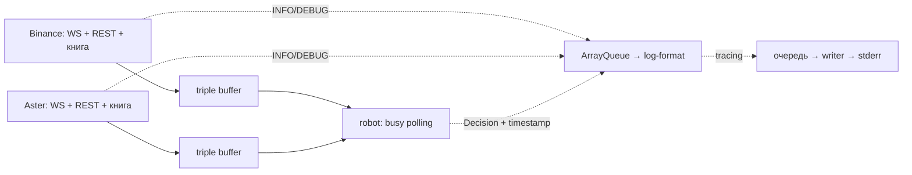

# Архитектура

Один процесс, два публичных фида ETHUSDT perpetual и сигнал без исполнения. [Параметры и URL](../README.md).

## Потоки и владение

Один Tokio multi-thread runtime с двумя worker-потоками: адаптеры запускаются отдельными `tokio::spawn`, supervision работает в том же runtime. Робот с busy loop, общий форматировщик событий и общий writer логов — отдельные OS-потоки. Разбор snapshot использует общий blocking pool (не более двух потоков); каждый адаптер допускает не более одной задачи разбора одновременно.

`MDAdapter` задаёт endpoints, декодирование и запуск. `binance`/`aster` содержат endpoints и особенности протокола; `md::rest` — общие схемы snapshot/metadata; `md::diff` разбирает общую схему diff напрямую в подготовленный буфер; `md::feed` — общий сетевой цикл. Один `select!` обслуживает WS, HTTP, результат разбора snapshot, таймеры и shutdown. Replay ограничен 32 сообщениями за итерацию. Старый parse worker дожидаются, результат другой `sync_epoch` отбрасывают.

Адаптер владеет книгой и двумя предвыделенными `Box<DepthDiff>`: рабочим и последним принятым; после применения меняет их местами. Декодер проверяет шаги/диапазон и преобразует цену в индекс. Уникальность цен проверяется строгим порядком либо битовой картой с очисткой затронутых слов, включая ошибки. Сортировка выполняется только при повторном `final_id` для сравнения содержимого.

Каждая сторона — массив `1 << 20` количеств по индексу `price / tick_size - base_ticks`; нулевое количество означает отсутствие уровня. База общая для bid/ask, выбирается вокруг mid snapshot с учётом числовых границ и фиксируется до следующего snapshot. Двухуровневая битовая карта ускоряет обход занятых цен. Diff меняет свои ячейки и после проверки spread/top-5 перестраивает только затронутый кэш top-20. Ошибка требует Offline и нового snapshot; полный сброс массивов выполняется при его загрузке.

Робот получает top-20 каждой стороны (`ArrayVec<Level, 20>`) через предвыделенный triple buffer, без аллокаций и ожидания читателя. Версия остаётся целостной до `update()`; книги бирж независимы.

Хранение книги — около 16,25 MiB на фид вместе с битовыми картами и кэшем top-20; отдельно 128 KiB на проверку повторных цен diff. Шаг цены берётся из метаданных; ширина окна — `(BOOK_PRICE_SLOTS - 1) × tick_size`. Выход за диапазон логируется как ERROR и вызывает Offline/resync с пересчётом базы; размер массивов неизменен.

Робот непрерывно проверяет оба буфера. Считает при обновлении, истечении свежести или секундном deadline; пустой проход использует `spin_loop()`. Сеть не парсит. `exchange_time` (биржевое E, Unix ms) и `platform_time` (локальный монотонный `Instant`) сохраняются в книге. Возраст/skew считаются по `platform_time`, взятому до парсинга и буферизации полного WS-сообщения.

## Восстановление и сигнал

WS-буферизация → snapshot `L` → отбросить `u < L` → первое `U <= L <= u` → далее `pu == previous_u`. Ноль удаляет уровень; количество абсолютное. После bridge и опустошения очереди — Online.

Gap, disconnect, timeout, плохой кадр, overflow или потеря достоверных top-5 → публикация Offline → восстановление. До ожидания snapshot/backoff адаптер повышает счётчик разрывов своей книги. Здоровый фид продолжает работать. Один Offline или устаревшая книга дают роботу Hold. Watchdog срабатывает через 3 с без применённого diff; max-age робота по умолчанию — 500 мс.

Triple buffer передаёт последнюю книгу без очереди накопленных версий и ошибок заполнения. Offline повышает отдельный глобальный `AtomicU64` своего фида — `BINANCE_OFFLINE_EPOCH` или `ASTER_OFFLINE_EPOCH`. Канал хранит статическую ссылку на счётчик без `Arc`; счётчик не сбрасывается. В процессе запускается один экземпляр сервиса.

Робот сначала приобретает книгу, затем читает поколение. Смена поколения заставляет его выдать Offline/Hold, даже если уже получена восстановленная книга. В следующем проходе робот снова забирает последнюю публикацию; Online допускается только для книги текущего поколения. Без новых публикаций уже приобретённая восстановленная книга становится Online, а книга до разрыва остаётся Offline. Несколько разрывов между чтениями объединяются в один Offline. Уровни и timestamps принадлежат приобретённой версии. Уже начатый расчёт может закончиться на прежних данных; разрыв обрабатывается при следующем `update()`.

Сигнал: `(mid_aster − mid_binance) / mid_binance × 10000`, где mid — полусумма best bid/ask; порог по умолчанию 2 bps (0,02%). Применяются фильтры возраста, skew и объёма top-5. Направления называются `LongBiasAster` / `ShortBiasAster`; нейтральное решение — `Hold`. `Price`/`Qty` — `fixnum<i64, U9>`; точный ASCII-парсер за один проход собирает raw `i64` с проверкой переполнения; сравнение mid — точные cross-products в `i128`, без округления. Callback выдаёт решение с числами обеих книг при смене bias/статуса и раз в секунду.

## Модули и завершение

- `main`, `config` — CLI и SIGINT/SIGTERM.
- `service` — запуск, контроль завершения workers и общий shutdown.
- `md`, `binance`, `aster` — протокол, транспорт и восстановление.
- `numeric`, `book` — числа, хранение и публикация.
- `robot` — расчёт и polling; `logging` — формат и вывод.

Supervision проверяет завершение задач фидов и потока робота каждые 10 мс; это не период реакции робота. Ошибка/panic/неожиданный выход worker останавливает остальных. Stop робота — `AtomicBool` с Relaxed (данных не передаёт), stop фидов — `watch`. Supervision ожидает результаты завершённых Tokio tasks и делает join завершившегося потока робота; адаптеры перед выходом публикуют Offline и дожидаются parse worker. `service::run` нужно дождаться до конца cleanup.

## Логи

`LEVEL:timestamp: событие параметры`, UTC. INFO — Online/Offline и смена bias Aster с числами обеих книг; WARN/ERROR — биржа и причина сбоя, для восстановления также `action=reconnect/resync` и `retry_in_ms`; DEBUG — короткая диагностика и периодические решения. `feed state` передаёт состояние адаптера: состояние и последний применённый `u`, сохранённый при восстановлении. Дубли ID не меняют.

В терминале Online — синий фон, bias — зелёный, Offline/WARN/ERROR — красный; в файле ANSI нет. Робот и фиды без аллокаций отправляют типизированные INFO/DEBUG-события с исходным временем в общую предвыделенную `ArrayQueue` (MPSC). Поток `log-format` вызывает `tracing` и спит 1 мс при пустой очереди; это задерживает только вывод. Переполнение отбрасывает новую запись; фоновый поток пишет ERROR с числом потерь.

WARN/ERROR на путях ошибок пока форматируются вызывающим потоком. Общий writer `tracing-appender` принимает готовые строки через вторую lossy-очередь. Обе очереди вмещают 4096 записей; порядок вывода между потоками не гарантирован. При завершении после остановки производителей дочитываются события, затем `WorkerGuard` сбрасывает строки writer.
